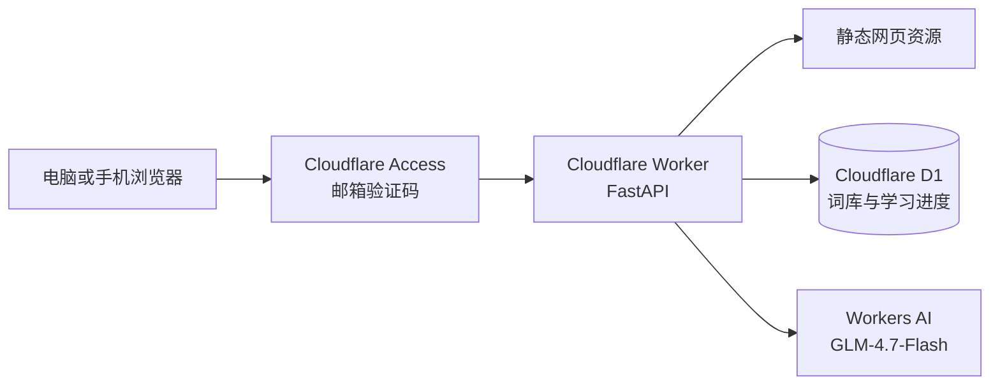

# Cloudflare 部署与维护

## 当前线上环境

- 网站：<https://vocab-study.silverhark99.workers.dev>
- Worker：`vocab-study`
- 数据库：Cloudflare D1 `vocab-study-db`（亚太区域）
- AI：Workers AI `@cf/zai-org/glm-4.7-flash`
- 入口目录：`cloudflare/`
- 登录保护：Cloudflare Access 邮箱一次性验证码

## 部署架构



原来的本地 FastAPI + SQLite 版本保持不变。Cloudflare 适配代码独立放在 `cloudflare/` 中，网页外观和主要功能沿用原项目。

## 关键文件

- `cloudflare/src/worker.py`：Cloudflare Python Worker、API、D1 和 AI 调用。
- `cloudflare/public/index.html`：云端前端页面。
- `cloudflare/migrations/0001_schema.sql`：D1 表结构。
- `cloudflare/wrangler.jsonc`：Worker、静态资源、D1 与 AI 绑定。
- `cloudflare/pyproject.toml`：Python 依赖。
- `cloudflare/uv.lock`：依赖锁文件。

个人数据库、导入 SQL、Wrangler 本地状态、虚拟环境和构建产物都已由 `.gitignore` 排除，不得提交到 GitHub。

## 首次部署方法

前置条件：Node.js、`uv`、Cloudflare Wrangler，并已执行 `wrangler login`。

```powershell
cd cloudflare
uv run pywrangler sync
npx wrangler d1 create vocab-study-db --location apac
npx wrangler d1 migrations apply vocab-study-db --remote
npx wrangler deploy
```

创建 D1 后，将返回的 `database_id` 写入 `cloudflare/wrangler.jsonc`。个人数据迁移应使用私有 SQL 文件执行，严禁把该文件加入仓库：

```powershell
npx wrangler d1 execute vocab-study-db --remote --file <私有数据文件.sql>
```

Cloudflare Python 工具在部分 Windows 环境存在 Pyodide 依赖同步问题；Linux/macOS 或 Cloudflare 的云端构建环境更适合执行 `uv run pywrangler sync`。

## 日常更新

修改代码并完成测试后：

```powershell
git add .
git commit -m "描述本次修改"
git push origin main
cd cloudflare
uv run pywrangler deploy
```

如果已在 Cloudflare Workers Builds 中连接 GitHub，可把生产分支设为 `main`、根目录设为 `cloudflare`，部署命令设为 `uv run pywrangler deploy`，以后推送 `main` 即可自动部署。

## 数据备份与恢复

定期从 D1 导出备份：

```powershell
cd cloudflare
npx wrangler d1 export vocab-study-db --remote --output ..\vocab-study-backup.sql
```

备份文件包含私人词库和学习记录，必须存放在非公开目录，不能提交 GitHub。恢复前应先创建新的 D1 或确认目标数据库，避免覆盖错误环境。

## 验证清单

- 首页返回 HTTPS 200。
- `/api/health` 返回 D1 且单词数正确。
- 词书、单词详情、学习会话、答题记录和统计接口正常。
- Workers AI 可生成词性、短语和例句。
- Cloudflare Access 未登录时要求邮箱验证码。
- 登录后在电脑和手机上看到相同的 D1 学习进度。

## 回滚

代码故障时，可在 Cloudflare Dashboard 的 Worker 部署记录中选择上一个正常版本并回滚。数据故障与代码回滚相互独立；D1 应使用导出的 SQL 备份恢复，操作前先核对数据库名称和备份日期。

## 免费额度注意事项

该部署使用 Workers、静态资源、D1、Workers AI 和 Access 的免费能力。免费额度不是无限资源；达到 Workers AI 当日免费额度后，AI 生成功能会暂时不可用，但背词、复习和统计仍可继续使用。应在 Cloudflare 控制台定期查看用量，不主动启用付费计划。
